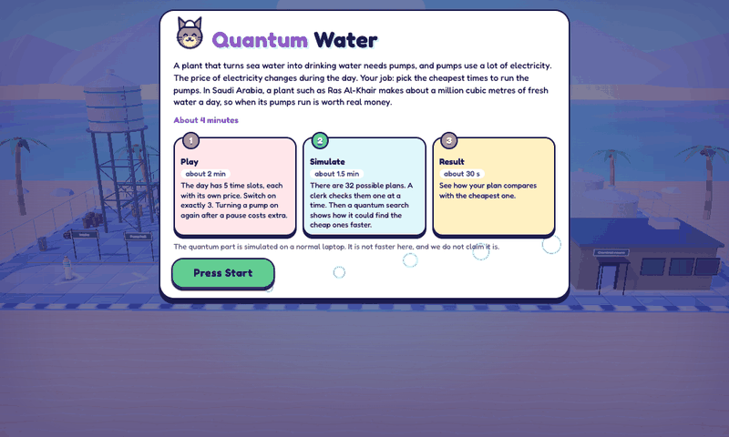

# Quantum Water

[**Play it in your browser**](https://hasanbgit.github.io/quantum-water-game-arcade/) · MIT licence · English and Arabic



A free 3D browser game that teaches **quantum computing** and **Grover's search algorithm** through one question: when should a desalination plant run its pumps to pay the least for electricity?
You run the plant for a day (exactly 3 of 5 time slots, lowest bill), talk to the helpers, press Simulate to watch a search look for a cheaper plan, then see the result.

**Who it is for:** middle and high school students, teachers, and anyone curious about quantum computing. No install, no maths needed, about 4 minutes. Works on phones and laptops, in English and Arabic. Built with three.js, based on a Qiskit Fall Fest notebook.

Everything quantum is **simulated on a laptop**. The game does not claim a quantum advantage, and says so.

## Run it
```
npm install
npm run dev          # the game, usually http://localhost:5173/
```
Add `?skip` to the address to skip the intro, `?lang=ar` for Arabic.

Controls: arrow keys or W A S D to walk. E (or Space, or a tap on the button) at a control post switches its slot. E near a helper starts a conversation (arrows and Enter or a number to reply, Esc to leave). O for the overview, M for sound. You can also click or tap a control post or a helper and the operator walks there.

## What is in it
| Part | Where |
|---|---|
| The maths (cost, 32 plans, Grover steps, one search round) | `src/math/` |
| The plant, equipment, pipes, signs | `src/game/world.js`, `builders.js`, `site.js` |
| Bill panel, control posts, pump shake | `bill.js`, `billpanel.js`, `terminals.js`, `pumps.js` |
| Helpers and conversations | `npcs.js`, `dialogue.js`, `scripts.js`, text in `src/strings.js` |
| Quest log | `quest.js` |
| Guided flow: intro, coach, Simulate, Result | `flow.js`, `tankField.js` |
| Quality tiers (high, medium, low), chosen from the device and measured frame time | `quality.js` |
| Arabic and right-to-left | `src/strings.ar.js`, `src/i18n.js` |
| Audience mode for a talk | `server/`, `room/` |
| Sound (sea, wind, machinery, birds), made in the browser | `audio.js` |

## Audience mode
```
npm run room
```
It prints a big-screen address and the address for phones (same Wi-Fi). People pick their own 3 slots on their phones; the big screen shows which bills the room got and how many found the cheapest plan. Votes are kept in memory, there are no accounts, and nothing leaves the local network.

## Checks
```
npm test                    # logic tests: maths, bill, conversations, tiers, Arabic text, audience tally
npm run verify:snapshot     # builds a copy and drives a real browser through the whole game
npm run assets-doc          # rewrites ASSETS.md from public/assets/manifest.json
```
`verify:snapshot` picks free ports each run, so it can run while someone else is editing or running their own checks. It writes screenshots to `verify-output/`.

## Assets and licences
`ASSETS.md` lists every downloaded model, texture and sky (all CC0, from Poly Haven) with source and licence. Characters, scenery and equipment are built in code. The sound is made in the browser, so there is nothing to credit. The game loads three fonts from Google Fonts at run time (Fredoka for English, Readex Pro and Baloo Bhaijaan 2 for Arabic), each under the SIL Open Font Licence. The 3D engine is [three.js](https://threejs.org/) (MIT).

## Where the maths comes from
The cost function and the Grover steps follow the notebook "Desalination scheduling: when should the plant run?" from the KACST Qiskit Fall Fest 2026 (equations for the penalty, the oracle, the inversion about the average and the success chance sin²((2k+1)θ)). The game's own prices and restart cost are an extension of that notebook's formula, chosen so that the three cheapest slots are not the best plan.

## Contributing
Contributions are welcome: see [CONTRIBUTING.md](CONTRIBUTING.md). Start with `npm test`.

## Licence
MIT, see [LICENSE](LICENSE). Third-party assets keep their own licences, listed in `ASSETS.md`.
